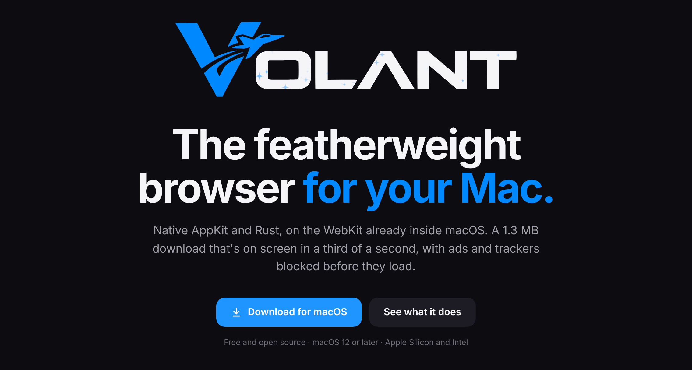
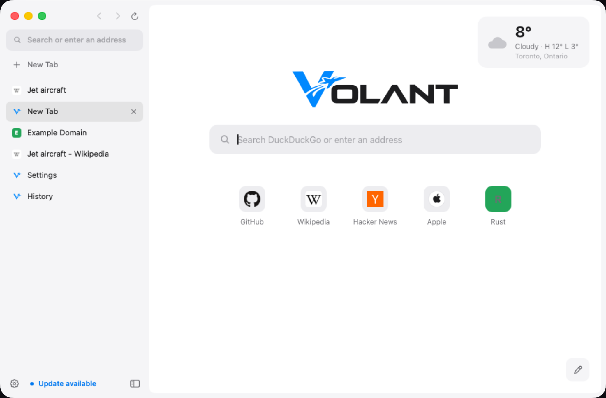
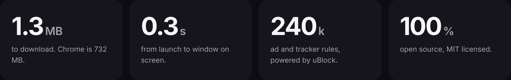
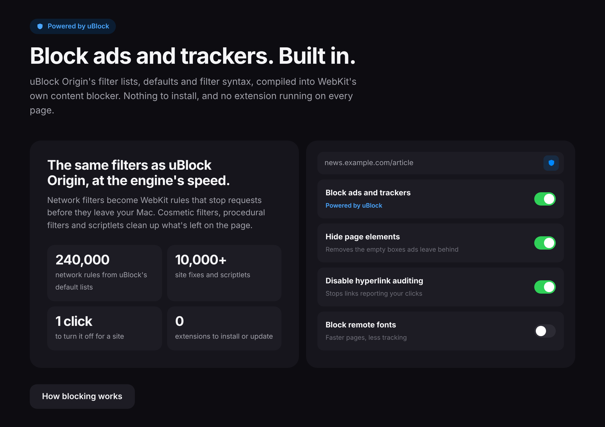
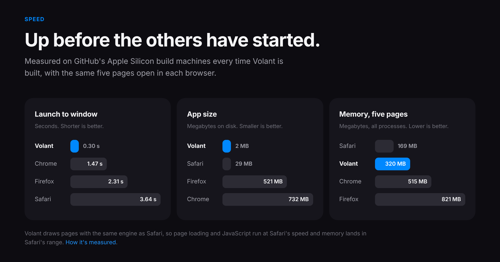
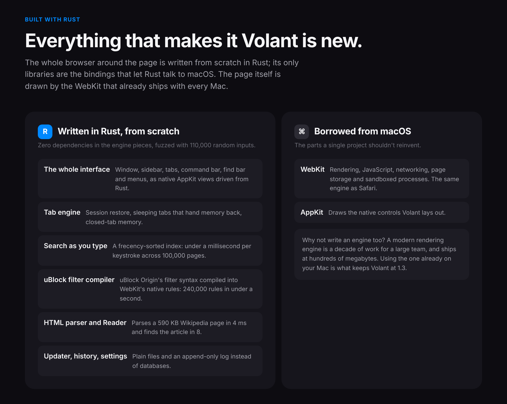
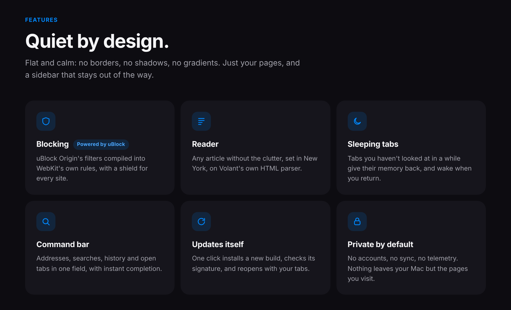

<!-- The panels below are rendered from the landing page in docs/ (docs/readme/*.png). -->
<p align="center">
  <a href="https://rowanmartian.github.io/volant/"></a>
</p>
<p align="center">
  <a href="https://github.com/RowanMartian/volant/releases/download/latest/Volant.dmg"></a>
</p>
<p align="center">
  
</p>
<p align="center">
  <a href="https://rowanmartian.github.io/volant/blocking.html"></a>
</p>
<p align="center">
  
</p>
<p align="center">
  
</p>
<p align="center">
  
</p>
<p align="center">
  <a href="https://github.com/RowanMartian/volant/releases/download/latest/Volant.dmg"></a>
</p>

<p align="center">
  <a href="https://github.com/RowanMartian/volant/releases/download/latest/Volant.dmg"><b>Download Volant.dmg</b></a> &nbsp;·&nbsp; <a href="https://rowanmartian.github.io/volant/">Website</a> &nbsp;·&nbsp; <a href="https://github.com/RowanMartian/volant/releases/tag/latest">Release notes</a> &nbsp;·&nbsp; MIT License
</p>

---

## Install

1. Go to **Releases** → **Volant — latest build** and download **Volant.dmg**.
2. Open it and drag **Volant** onto **Applications**.
3. The first time, macOS warns that it can't verify the developer, because Volant isn't notarized by Apple.
   Go to **System Settings → Privacy & Security**, scroll down, and click **Open Anyway**. Or run this once:
   ```bash
   xattr -cr /Applications/Volant.app
   ```

Volant needs macOS 12 Monterey or later, on Apple Silicon or Intel.

## Keyboard

| | |
| --- | --- |
| ⌘T | New tab, ready to search or type an address |
| ⌘L | The command bar: addresses, searches, history and open tabs |
| ⌘S | Show or hide the sidebar |
| ⌘D | Pin or unpin the current tab |
| ⇧⌘T | Reopen the last tab you closed |
| ⌘W | Close tab |
| ⌘1 – ⌘9 | Jump to a tab (⌘9 is always the last one) |
| ⌃Tab, ⇧⌘] / ⇧⌘[ | Next / previous tab |
| ⌘F, ⌘G, ⇧⌘G | Find on page, next, previous |
| ⌥⌘B | Block an element on the page |
| ⇧⌘R | Reader |
| ⌘[ / ⌘] | Back / forward |
| ⌘+ / ⌘- / ⌘0 | Zoom in / out / actual size |
| ⌘Y | History |
| ⌘, | Settings |

⌘-click or middle-click a link to open it in a background tab (add ⇧ to switch to it). Right-click a tab to pin, duplicate, copy its link or close others.

### The home page

Click the pencil in the bottom-right corner to add your favourite sites (drag to reorder) and to turn on the weather widget.
Weather comes from [Open-Meteo](https://open-meteo.com), free and without an account; only the city you choose is sent, and only while the widget is on.

### Updates

Volant checks GitHub for a newer build at launch and every few hours, or when you choose **Volant → Check for Updates…**.
Updating downloads the new app, checks its signature, swaps it in when Volant quits, and reopens it. If Volant can't write to the folder it's in, it opens the download page instead.

### Block ads and trackers (Powered by uBlock)

Volant's blocker runs [uBlock Origin](https://github.com/gorhill/uBlock)'s filter lists, with uBlock Origin's
default selection and filter syntax, built into the browser. It's on from the first launch; one switch in
Settings turns it off.

- Network filters are compiled by Volant (in Rust) into WebKit's native content blocker: about 240,000 rules
  from the default lists, in under a second. Requests are stopped inside WebKit before they're sent.
- Cosmetic filters, procedural filters (`:has-text`, `:upward`, `:xpath`, …) and 33 of uBlock Origin's
  scriptlets are added to each page for its site only.
- **The shield** in the address bar turns blocking off (and back on) for the site you're on.
  Right-click it, or press ⌥⌘B, to **block an element** with the picker.
- **Volant → Blocker Settings…** has uBlock Origin's settings: hide page elements, hyperlink auditing,
  WebRTC, remote fonts, JavaScript, the whole filter list catalogue, My filters and trusted sites.
- Lists refresh every four days. `$redirect` filters block instead; `$removeparam`, `$csp`, `$header`
  and HTML filters are skipped, because WebKit's content blocker can't rewrite requests or pages.

uBlock Origin is by Raymond Hill and contributors (GPLv3). Volant is an independent project, not made or
endorsed by them. [More about blocking](https://rowanmartian.github.io/volant/blocking.html).

### Where things live

Settings, your open tabs and history are plain text files in `~/Library/Application Support/Volant`.
Downloads go to your Downloads folder.

## Build it yourself

GitHub builds Volant on every push (`.github/workflows/build-macos.yml`): it runs the tests, builds a
universal app, drives it through a smoke test with screenshots, installs the previous release over a
copy of itself to test the updater, benchmarks it against Safari, Chrome and Firefox, and publishes
**Volant.dmg**.

On a Mac with Rust installed:

```bash
bash scripts/bundle-macos.sh
```

```bash
open dist/Volant.app
```

The engine pieces build and test on any OS:

```bash
cargo test -p volant-core
```

```bash
cargo run --release -p volant-core --example bench
```

| Folder | What's in it |
| --- | --- |
| `crates/core` | Everything platform-independent, with zero dependencies: address bar logic, history and its search index, the HTML parser and Reader, the uBlock filter compiler, the tab model, settings. |
| `crates/app` | The macOS app: AppKit window and sidebar, command bar, find bar, menus, web views, downloads, blocking, updater. |
| `assets/pages` | Volant's own pages: welcome, home, settings, blocker, history, Reader, errors. |
| `assets/ublock` | The scripts the blocker adds to pages: scriptlets, cosmetic and procedural filtering, the element picker. |
| `site` | The website's pages; `python3 scripts/build-site.py` builds them into `docs`. |
| `docs` | The built website (GitHub Pages), and the panels at the top of this page. |
| `scripts/bench` | The browser comparison CI runs. |

Benchmarks vary on shared build machines; across runs Volant launched in 0.29–1.04 s, Safari 2.1–3.6 s,
Chrome 0.60–1.5 s and Firefox 1.3–2.3 s. Memory with five pages: Volant 253–320 MB, Safari 160–308 MB,
Chrome 515–527 MB, Firefox 805–823 MB.

## Design

Flat and quiet: no borders, no shadows, no gradients. Surfaces are told apart by fill alone, everything
you can click has rounded corners, and the system font does the talking. The mark is a V with a jet
breaking away from it, in Volant blue (#0088FE); in square icons the V sits dead centre and the jet
flies off to the right.
